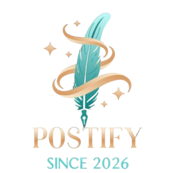
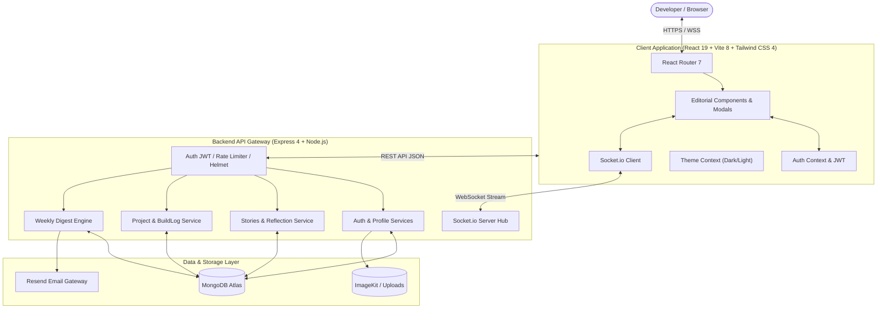

<p align="center">
  
</p>

<h1 align="center">Postify</h1>

<p align="center">
  <strong>The Editorial Platform for Developer Reflections, Engineering Build Logs & Real-Time Technical Communities</strong>
</p>

<p align="center">
  <a href="https://react.dev/"></a>
  <a href="https://tailwindcss.com/"></a>
  <a href="https://nodejs.org/"></a>
  <a href="https://expressjs.com/"></a>
  <a href="https://www.mongodb.com/"></a>
  <a href="https://socket.io/"></a>
  <a href="https://vitejs.dev/"></a>
  
</p>

---

## 🌟 Executive Overview

**Postify** bridges the gap between raw git commit messages and deep engineering storytelling. Designed specifically for software engineers, open-source maintainers, and technology architects, Postify provides an editorial haven where developers share technical reflections, document chronological project build logs, organize bookmarked collections, and engage with a global developer network in real time.

Built with a **Twilight Editorial** design philosophy, Postify pairs classical typography with glowing glassmorphism, responsive navigation capsules, and a resilient full-stack architecture.

---

## 🚀 Key Feature Matrix

| Feature | Description |
| :--- | :--- |
| ✍️ **Technical Reflections** | Write technical insights in Markdown with syntax highlighting, live preview, quote posting, pinned stories, and verification badges. |
| 🛠️ **Project Showcase & Build Logs** | Showcase repositories and products with live tech stack pills, project stages, and chronological micro-logs (`milestone`, `feature`, `fix`, `refactor`, `research`). |
| 📬 **Automated Weekly Digest** | Dynamic cron-scheduled email & in-app digest compiling personalized updates from followed builders, trending discussions, and fresh build milestones. |
| ⚡ **Real-Time Sockets & Telemetry** | Instant notifications for replies, mentions, quote-posts, and bookmarks powered by bidirectional Socket.io channels. |
| 🔍 **Full-Text Debounced Search** | High-performance search with abortable requests across stories, users, projects, and tag taxonomies. |
| 🎨 **Dual-Atmosphere Theme System** | Seamless, flicker-free toggle between Twilight Light Editorial and Sleek Obsidian Dark themes with custom HSL token variables. |
| 🛡️ **Fault-Isolated System Pages** | Built-in React Error Boundary, rich animated loading screens, custom 404 Not Found, 500 Server Interruption, 503 Maintenance, and Coming Soon teaser pages. |
| 📱 **Mobile-First Responsive Design** | Fluid layouts optimized for mobile devices, tablets, and ultra-wide screens with accessible ARIA landmarks. |

---

## 🏗️ System Architecture



---

## 💻 Tech Stack

### Frontend Client
- **Core Library**: React 19
- **Build Tool**: Vite 8 (Hot Module Replacement, fast tree-shaking)
- **Styling**: Tailwind CSS v4 (Custom color tokens, native dark variants)
- **Motion & Aesthetics**: Framer Motion, Lucide Icons, Prism.js, Marked, DOMPurify
- **State & Routing**: React Router v7, React Context, React Helmet Async

### Backend Engine
- **Server Framework**: Node.js & Express 4
- **Database**: MongoDB with Mongoose ODM
- **Real-Time Communication**: Socket.io
- **Security & Auth**: JSON Web Tokens (JWT), BCrypt, Cookie-Parser, Helmet, Express Rate Limit
- **Media Processing**: Multer, ImageKit CDN integration
- **Email Delivery**: Resend SDK

---

## 📁 Repository Structure

```text
Postify/
├── assets/                       # Brand graphics and project logo
├── client/                       # React 19 Frontend application
│   ├── public/                   # Static assets, sitemap, logos, icons
│   └── src/
│       ├── components/           # Modular UI component library
│       │   ├── auth/             # Login, register, and auth panels
│       │   ├── common/           # LoadingScreen, ErrorBoundary, ThemeToggle, Button, etc.
│       │   ├── digest/           # Weekly digest settings & subscriber modals
│       │   ├── layout/           # FloatingNav, ProtectedRoute, Layout
│       │   ├── posts/            # PostCard, PostFeed, PostForm, QuoteModal
│       │   ├── profile/          # ProfileHeader, ProfileEditModal, SelectedProjectsSection
│       │   └── projects/         # ProjectModal, BuildLogModal
│       ├── context/              # AuthContext, ThemeContext, SocketContext, NotificationContext
│       ├── pages/                # Landing, Feed, Projects, Digest, 404, 500, Maintenance, Coming Soon
│       ├── services/             # Axios API client, bookmark, digest, project services
│       ├── App.jsx               # Route mappings and top-level Suspense & ErrorBoundary
│       ├── index.css             # Design tokens, fonts, and dark mode theme definitions
│       └── main.jsx              # React DOM entrypoint
├── models/                       # Mongoose database models (User, Post, Project, BuildLog, etc.)
├── server/                       # Node.js backend services and controllers
│   └── src/
│       ├── config/               # Database and environment configurations
│       ├── controllers/          # Express route controllers
│       ├── middleware/           # Auth, file upload, validation, and rate limiters
│       ├── routes/               # Modular REST endpoints
│       ├── services/             # Notification and digest generation engines
│       └── server.js             # Express & Socket.io server bootstrap
├── .env.example                  # Comprehensive environment variable template
├── app.js                        # App setup & middleware pipeline
├── render.yaml                   # Infrastructure-as-code specification for Render
└── package.json                  # Root scripts and workspace dependencies
```

---

## 🛠️ Getting Started

### Prerequisites
- **Node.js**: v18.0.0 or higher
- **npm**: v9.0.0 or higher
- **MongoDB**: Local MongoDB instance or free MongoDB Atlas URI

### 1. Clone the Repository
```bash
git clone https://github.com/MdAfnanNaushad/Postify.git
cd Postify
```

### 2. Configure Environment Variables
Create your local `.env` file from the provided template:
```bash
cp .env.example .env
```
Fill in the required variables (see [Environment Variables](#-environment-variables) below).

### 3. Install Dependencies
```bash
# Install root and backend dependencies
npm install

# Install client dependencies
npm --prefix client install
```

### 4. Run Development Servers
You can run both backend and frontend concurrently:

```bash
# Terminal 1: Run Backend API & WebSockets (Port 5000)
npm run dev

# Terminal 2: Run Frontend Vite Dev Server (Port 5173)
cd client
npm run dev
```

Visit `http://localhost:5173` to explore Postify locally.

---

## ⚙️ Environment Variables

| Variable | Description | Default / Example |
| :--- | :--- | :--- |
| `NODE_ENV` | Application environment (`development` / `production`) | `development` |
| `PORT` | Backend server port | `5000` |
| `MONGODB_URI` | MongoDB connection string | `mongodb://127.0.0.1:27017/postify` |
| `JWT_SECRET` | 32+ character secret for cryptographic JWT tokens | *(Required secret)* |
| `JWT_EXPIRES_IN` | Token duration | `7d` |
| `CLIENT_URL` | Frontend origin for CORS and redirects | `http://localhost:5173` |
| `CANONICAL_APP_URL` | Canonical domain for OpenGraph previews and SEO | `http://localhost:5173` |
| `RESEND_API_KEY` | Resend API key for Weekly Digest emails (Optional) | `re_123456789...` |
| `EMAIL_FROM` | Sender address for outgoing digest emails | `Postify <digest@postify.dev>` |

---

## 🌐 System & Status Page Routes

Postify includes a full suite of beautifully themed status and recovery pages:

| Route | Page | Purpose |
| :--- | :--- | :--- |
| `/` | **Landing Page** | Editorial landing showcasing features, marquee, and value proposition |
| `/feed` | **Community Feed** | Live developer reflections stream with filtering and sorting |
| `/projects` | **Projects Hub** | Developer project catalog with tech stacks and build logs |
| `/digest` | **Weekly Digest** | Personalized engineering digests with preferences modal |
| `/search` | **Search Hub** | Instant debounced multi-entity query engine |
| `/500` | **Server Interruption** | HTTP 500 failure page with live connection tester and telemetry status |
| `/maintenance` | **Maintenance Mode** | Scheduled downtime notice with stage tracker and notification waitlist |
| `/coming-soon` | **Coming Soon** | Feature roadmap teaser, countdown clock, and early-access invite |
| `*` | **404 Not Found** | Editorial 404 page with in-page search and smart navigation pills |

---

## 🚢 Production Deployment

Postify is turnkey-ready for deployment on **Render**, **Railway**, or **AWS**:

1. **Build Step**:
   ```bash
   npm run build
   ```
   This automatically installs all dependencies and compiles the Vite client bundle into `client/dist`.

2. **Start Command**:
   ```bash
   npm start
   ```

3. **Infrastructure as Code**:
   A complete [`render.yaml`](./render.yaml) is included for zero-friction one-click deployment.

---

## 🤝 Contributing

Contributions, issues, and feature requests are welcome!
1. Fork the Project
2. Create your Feature Branch (`git checkout -b feature/AmazingFeature`)
3. Commit your Changes (`git commit -m 'Add some AmazingFeature'`)
4. Push to the Branch (`git push origin feature/AmazingFeature`)
5. Open a Pull Request

---

## 📄 License

Distributed under the **ISC License**. See [`package.json`](./package.json) for details.

---

<p align="center">
  Crafted with care for developers who build in public.
</p>